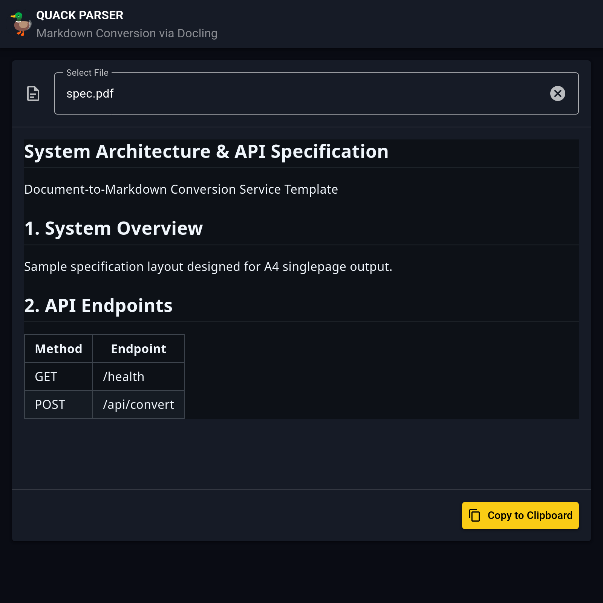

# QuackParser

## 🤝 Human-AI Synergy

**A Next-Generation Development Experience**

This project was built by pushing the boundaries of human vision and AI execution. The majority of the development was realized by orchestrating the AI coding agent **Cline**.

The core strategy was a sophisticated division of roles tailored to the strengths of different Large Language Models:

- **Plan** (Architecture & High-level Logic): `Gemma 4 12B UD-Q8_K_XL`
- **Act** (Precise Implementation & Coding): `Ornith 1.5 9B Q8_0`
- **Support**: `Gemini 3.5 Flash Lite` provided overarching guidance.

By decomposing large objectives into granular tasks and layering precise instructions, we assembled this refined architecture. This is the result of mastering AI not just as a "tool," but as a **"collaborative partner"** through strategic model orchestration. **We are currently pushing these boundaries further, experimenting with `Gemma 4 31B UD-IQ3_XSS` and `Gemma 4 12B UD-Q6_K_XL` to find the ultimate balance between reasoning depth and execution speed.**

---

QuackParser is a full-stack API service that leverages the advanced **Docling** library to convert uploaded documents into high-quality **Markdown** format. It features a modern **Vuetify** frontend for a seamless user experience.

## 📸 Demo



> **Try it yourself:** Download the sample specification PDF used in this screenshot: [sample/spec.pdf](sample/spec.pdf)

## 🌟 Features

- **Docling Integration**: Uses state-of-the-art document parsing technology to accurately convert complex layouts into clean, structured Markdown.
- **FastAPI Backend**: A high-performance, type-safe Python backend for efficient data processing.
- **Vuetify Frontend**: A sleek and responsive user interface built with Vue.js and Vuetify.
- **In-Memory Processing**: Processes binary data entirely in memory, making it ideal for containerized environments.
- **Docker Ready**: Fully containerized with Docker and Docker Compose for easy deployment.

## 🛠 Tech Stack

- **Backend**:
  - Language: Python 3.14+
  - Framework: FastAPI
  - Parsing: Docling
  - Package Manager: `uv`
- **Frontend**:
  - Language: Node.js 26+
  - Framework: Vue.js
  - UI Library: Vuetify
  - Build Tool: Vite
- **Infrastructure**:
  - Docker, Docker Compose

## 🚀 Quick Start

### 1. Clone the Repository

```bash
git clone https://github.com/karakuri-work/quackparser.git
cd quackparser
```

### 2. Install Dependencies

**Backend:**

```bash
cd Backend
uv sync
```

**Frontend:**

```bash
cd ../Frontend
npm install
```

### 3. Run the Development Environment

**Note**: On the first run (or first request), Docling models will be downloaded automatically. This may take some time depending on your network connection.

To run the application, open two separate terminals:

**Terminal 1: Backend**

```bash
cd Backend
uv run fastapi dev app/main.py
```

**Terminal 2: Frontend**

```bash
cd Frontend
npm run dev
```

Once started, access the application at:

- **Frontend**: `http://localhost:3000`
- **API Docs (Swagger)**: `http://localhost:8000/docs`

## 🐳 Docker & Compose

For a quick setup using Docker:

```bash
docker compose up -d --build
```

The application will be accessible at `http://localhost:8000`. (Note: The Docker setup serves the complete application, including the pre-built frontend, through the backend service).

## 🧪 Testing

**Backend Tests:**

```bash
cd Backend
uv run python -m pytest
```

**Frontend Tests:**

```bash
cd Frontend
npm run test
```

## 📂 Project Structure

```text
.
├── Backend/           # FastAPI application
│   ├── app/           # Core logic (main.py, services.py, schemas.py)
│   ├── tests/         # Backend tests
│   └── pyproject.toml
├── Frontend/          # Vuetify / Vue.js application
│   ├── src/           # Frontend source code
│   ├── public/        # Static assets
│   └── package.json
├── dockerfile         # Docker build instructions
├── compose.yaml       # Docker Compose configuration
└── README.md
```

## 📝 License

This project is licensed under the MIT License - see the [LICENSE.md](LICENSE.md) file for details.
